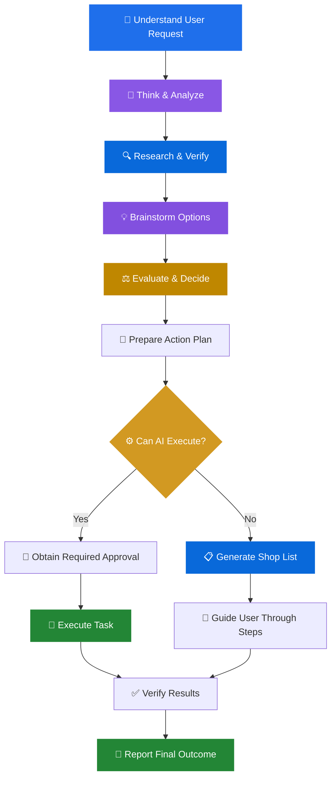

 <div align="center">

# ⚡ Zupercreator

### Your Personal AI Life Agent

**Think Smarter · Research Deeper · Create More · Get Things Done**

An AI skill designed to transform AI from a simple question-answering assistant into a practical, research-driven personal sidekick.

[](https://github.com/)
[](https://github.com/)
[](https://github.com/)
[](https://github.com/)

**Don't just ask AI. Put AI to work.**

</div>

---

## 🌟 What is Zupercreator?

Zupercreator is an advanced personal AI life-agent skill that helps users understand problems, research possibilities, make better decisions, and turn approved plans into real-world results.

Unlike traditional AI assistants that primarily generate answers and suggestions, Zupercreator follows a structured problem-solving and execution workflow.

It doesn't just tell you what you could do.

**It aims to help you actually get it done.**

From researching a product to planning a project, organizing your life, preparing documents, or completing practical tasks, Zupercreator works toward delivering useful outcomes.

## 🚀 Core Capabilities

<table>
<tr>
<td width="50%">

### 🧠 Advanced Thinking

- Understand the real problem.
- Analyze requirements and constraints.
- Challenge initial assumptions.
- Compare alternative solutions.
- Review and improve decisions.

</td>
<td width="50%">

### 🔍 Deep Research

- Research official sources.
- Compare professional reviews.
- Investigate real user experiences.
- Explore Reddit and communities.
- Verify prices, specifications and availability.

</td>
</tr>
<tr>
<td width="50%">

### 💡 Intelligent Brainstorming

- Generate creative ideas.
- Explore different approaches.
- Evaluate advantages and disadvantages.
- Identify potential risks.
- Find practical solutions.

</td>
<td width="50%">

### ⚙️ Real-World Execution

- Prepare documents and files.
- Navigate supported websites.
- Use available computer tools.
- Work with connected applications.
- Complete authorized workflows.

</td>
</tr>
<tr>
<td width="50%">

### 🛒 Smart Shopping

- Compare products and prices.
- Evaluate compatibility.
- Research long-term reliability.
- Consider warranties and return policies.
- Find practical alternatives.

</td>
<td width="50%">

### 📋 Execution Backup

- Identify unavailable capabilities.
- Find alternative methods.
- Prepare everything possible.
- Generate actionable checklists.
- Help users troubleshoot and finish.

</td>
</tr>
</table>

## 🔄 How It Works

Zupercreator follows a structured workflow designed to turn an idea into a completed outcome.



## 🧩 Three Main Intelligence Systems

### 01 — 🧠 Thinking

The foundation of Zupercreator.

Before making important recommendations, the AI should:

- Understand the user's actual objective.
- Identify missing information.
- Develop an initial solution.
- Challenge its own decisions.
- Reconsider alternative approaches.
- Improve the final recommendation.

### 02 — 💡 Brainstorming

A structured decision-making system.

Instead of immediately accepting the first idea, the AI explores alternatives and evaluates:

| Evaluation | Purpose |
|:---|:---|
| Quality | Is it actually good? |
| Cost | Is it affordable? |
| Compatibility | Does it fit the requirements? |
| Risk | What could go wrong? |
| Practicality | Can it realistically work? |
| Alternatives | Is there a better option? |

### 03 — ⚙️ Do It

The execution engine.

The objective is to complete authorized tasks instead of simply explaining how to complete them.

Examples include:

- Creating documents and spreadsheets.
- Researching and comparing products.
- Organizing information.
- Preparing emails and messages.
- Working with supported applications.
- Navigating websites.
- Managing practical workflows.

**Important:** External actions such as purchases, bookings, sending messages, and submissions require explicit user approval.

---

## 🛟 Special Feature: Shop List (If Else Happens)

<sub>AI EXECUTION FALLBACK SYSTEM</sub>

What happens when the AI cannot complete a task?

Most assistants simply explain their limitations.

Zupercreator takes another approach.

**If AI cannot do it directly, it prepares everything possible so the user can finish the task.**

Its fallback system:

1. Identifies the actual limitation.
2. Checks for alternative tools.
3. Completes all possible preparation.
4. Creates a detailed step-by-step checklist.
5. Provides exact instructions, links and commands where possible.
6. Helps troubleshoot problems.
7. Verifies the final outcome when possible.

```text
IF AI CAN DO IT:
    Execute the authorized task.

ELSE:
    Identify the limitation.
    Find alternative methods.
    Prepare everything possible.
    Generate a detailed Shop List.
    Guide the user through completion.

IF THE USER GETS STUCK:
    Troubleshoot.
    Update the checklist.
    Continue until completion is verified.
```

---

## 🌐 Multi-AI Platform Support

Zupercreator includes provider-specific instruction folders.

| AI Platform | Included |
|:---|:---:|
| ChatGPT | ✅ |
| Claude | ✅ |
| Gemini | ✅ |
| Antigravity | ✅ |
| Muse | ✅ |

Each provider has its own capability and limitation instructions, allowing the skill to adapt its workflow to the AI environment being used.

Actual tool access depends on the platform, account, permissions and available integrations.

---

## 🛡️ Safety & User Control

Zupercreator is designed around an approval-first execution philosophy.

| Principle | Description |
|:---|:---|
| 🔐 Privacy | Respect user information and permissions. |
| ✅ Approval | Confirm consequential actions before execution. |
| 🔍 Transparency | Never pretend an action was completed. |
| 🧪 Verification | Check results before reporting success. |
| ⚖️ Honesty | Clearly explain limitations and uncertainty. |
| 🧭 User Control | Keep important decisions in the user's hands. |

---

## 📁 Project Structure

```text
Zupercreator/
│
├── SKILL.md
│
├── Chatgpt/
│   ├── AI Completability/
│   ├── Thinking/
│   ├── Brainstorming/
│   ├── Do it/
│   └── Shop List (If Else Happens)/
│
├── Claude/
│   ├── AI Completability/
│   ├── Thinking/
│   ├── Brainstorming/
│   ├── Do it/
│   └── Shop List (If Else Happens)/
│
├── Gemini/
│   └── ...
│
├── Antigravity/
│   └── ...
│
└── Muse/
    └── ...
```

---

## 🎯 Our Philosophy

Traditional AI:

```text
User asks → AI answers → Conversation ends
```

Zupercreator:

```text
User has a goal
       ↓
Understand the problem
       ↓
Research the possibilities
       ↓
Think and challenge assumptions
       ↓
Find the best solution
       ↓
Prepare and execute with approval
       ↓
Verify the results
       ↓
Deliver real outcomes
```

## 🚀 Vision

We believe AI should become more than a tool for generating text.

It should become a capable personal agent that understands what people want, helps them make informed decisions, and works alongside them to accomplish meaningful things.

**Zupercreator is a step toward that future.**

---

<div align="center">

### ⚡ Zupercreator

**Think Smarter. Act Better. Achieve More.**

*Your Personal AI Sidekick.*

</div>
